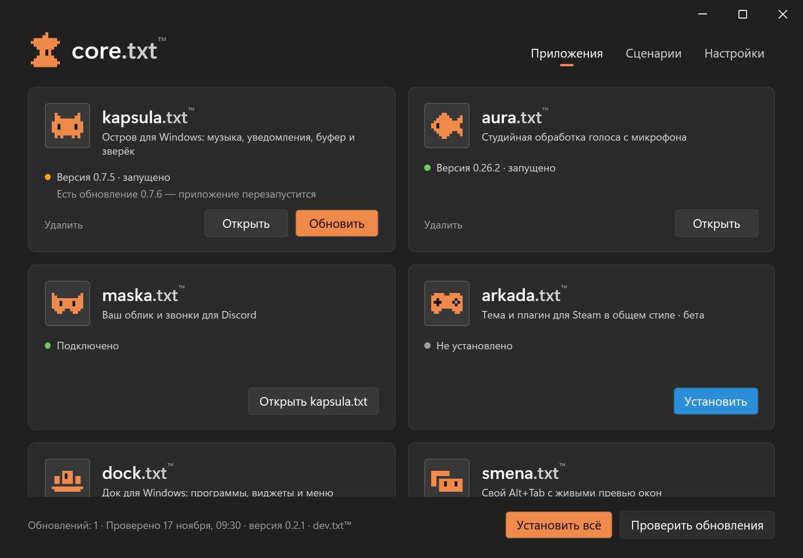
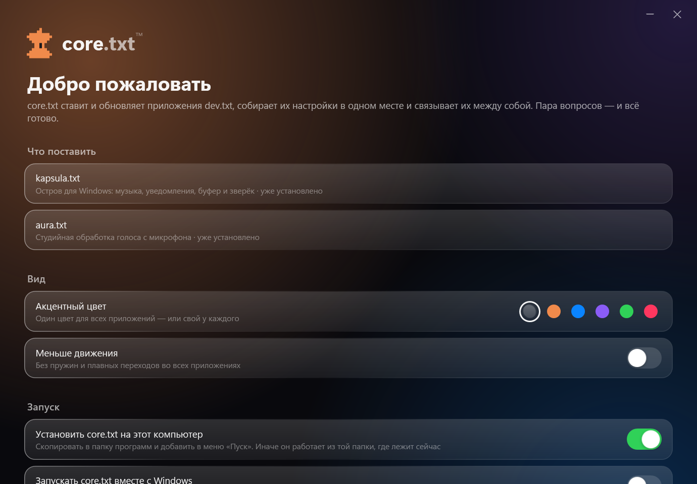
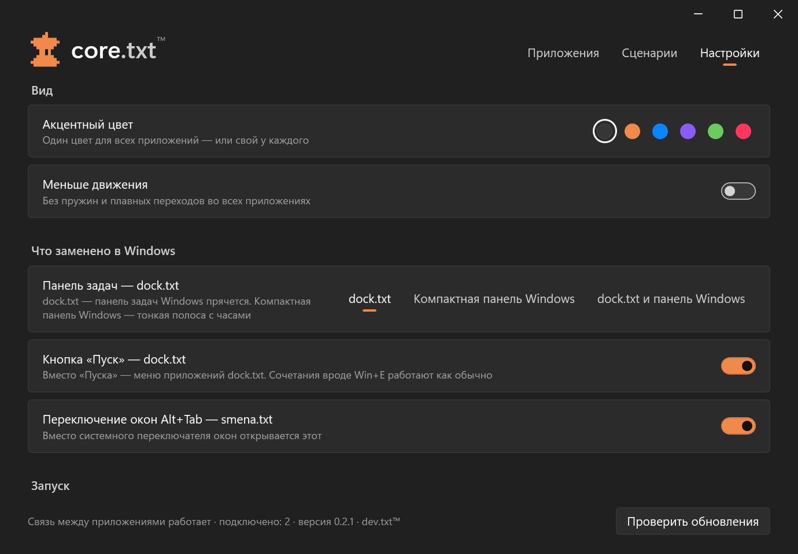

# core.txt

Лаунчер dev.txt™: одно окно для всех приложений — поставить, обновить, запустить.



## Что умеет

- Показывает каждое приложение: стоит ли оно, какая версия, запущено ли, есть ли обновление.
- Ставит и обновляет из релизов GitHub. Файл принимается, только если его размер и контрольная сумма SHA-256 совпали с указанными в релизе.
- Запускает приложения. Уже установленные находит сам — в том числе те, что лежат не в стандартной папке, если они запущены.
- Показывает, подключены ли Maska (для Discord) и Arkada (для Steam); подключаются они пока в самой Kapsula.

- Держит **хаб** — локальный канал, через который приложения видят друг друга. Для этого core.txt остаётся в трее после закрытия окна.
- Собирает **настройки всех приложений** на одной странице. Общие (акцентный цвет, «Меньше движения», запуск вместе с Windows, обновления) применяются ко всей экосистеме; свои настройки каждое приложение присылает через хаб, и core.txt рисует их одинаково.

- **Сценарии**: готовые правила, по которым приложения помогают друг другу. Пока верно условие (идёт звонок, запущена игра), сценарий держит настройку другого приложения в нужном значении, а потом возвращает как было. Каждый включается переключателем; новый сценарий — одна запись в `src/Scenarios.cs`.
- **Первый запуск**: одна страница вместо поиска по разным окнам — что поставить, какой акцентный цвет, ставить ли core.txt в папку программ и запускать ли его вместе с Windows (выключено, пока человек сам не включит).
- **Обновляет сам себя** из релизов своего репозитория, с той же проверкой размера и SHA-256.






## Как добавить приложение

Одной записью в [catalog.json](catalog.json). Лаунчер забирает свежий каталог из своего репозитория, так что пересобирать и переустанавливать его не нужно.

| Вид (`kind`) | Что это | Обязательные поля |
|---|---|---|
| `portable` | один exe, который просто кладётся в папку | `repo`, `asset`, `exe`, `process` |
| `installer` | установщик с «тихим» ключом | `repo`, `asset`, `silent`, `installed`, `process` |
| `integration` | подключение внутри другой программы | `marker`, `via`, `hint` |

- `repo` — только репозитории владельца `cxxperman`: каталог из сети не может увести лаунчер в чужой репозиторий.
- `asset` — имя файла в релизе, можно со звёздочкой: `Aura-Setup-*.exe`.
- Версия берётся из тега релиза вида `v1.2.3`.
- Запись с ошибкой или незнакомым видом пропускается и не ломает остальные.

## Сборка

```bash
powershell -ExecutionPolicy Bypass -File build.ps1
```

Собирается встроенным в Windows компилятором C#, как Kapsula: ничего ставить и скачивать не нужно. Получается один файл `Core.exe`.

## Проверка

```bash
./Core.exe --selftest
```

| Ключ | Что делает |
|---|---|
| `--selftest` | проверяет разбор каталога, выбор релиза и замену файла программы |
| `--latest` | спрашивает у GitHub последние версии и печатает их |
| `--demo` | выдуманные состояния приложений; сеть и диск не трогаются |
| `--shot файл.png` | рисует окно в файл и выходит |
| `--page имя` | открывает сразу страницу: `scenarios`, `settings` или `welcome` |
| `--tray` | запуск без окна: только значок в трее и хаб |
| `--hub порт` | только хаб, без окна — для проверок протокола из kit.txt |

## Оформление

Цвета, радиусы, шрифты и длительности — из `src/Tokens.cs`. Этот файл собирается в `kit.txt` и руками не правится.

## Одна папка

Всё, что ставит core.txt, лежит вместе: `%LOCALAPPDATA%\Programs\dev.txt` — сам `Core.exe` и по папке на приложение. Ярлыки — в одной папке `dev.txt` меню «Пуск».

Приложения, которые уже стоят в других местах, core.txt находит (по запущенному процессу, по записи автозапуска Windows, по прежним местам установки) и переносит по кнопке «Собрать» в настройках или на первом запуске: закрывает программу, перекладывает файл, поправляет её запись автозапуска и запускает снова. Переносится только то, что состоит из одного файла; Aura ставит установщик, и она остаётся на своём месте. Настройки приложений лежат отдельно и при переносе не трогаются.

## Удаление

У установленного приложения в углу карточки есть тихая ссылка «Удалить». Вопрос задаётся прямо на карточке, с переключателем «Стереть и настройки» (выключен).

- **Переносное приложение** (Kapsula, док и остальные): закрывается, убирается его файл, запись автозапуска и ярлык.
- **Aura:** запускается её собственный деинсталлятор, как это делает Windows — он знает, что ещё она оставила в системе (в том числе снимает модуль с микрофона).
- **Arkada:** убираются папки темы и плагина из Steam.
- **Настройки** стираются только по переключателю и только из папки, которую каталог назвал явно; она обязана лежать внутри профиля пользователя.

Из командной строки: `Core.exe --uninstall имя` (настройки остаются).
